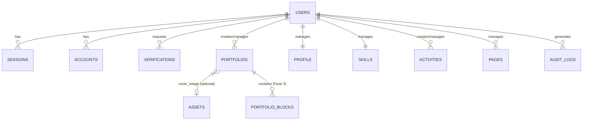
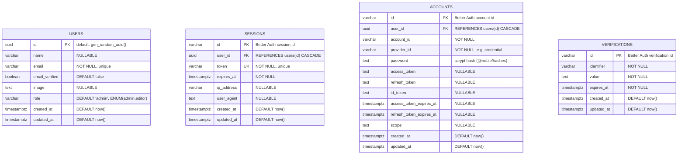
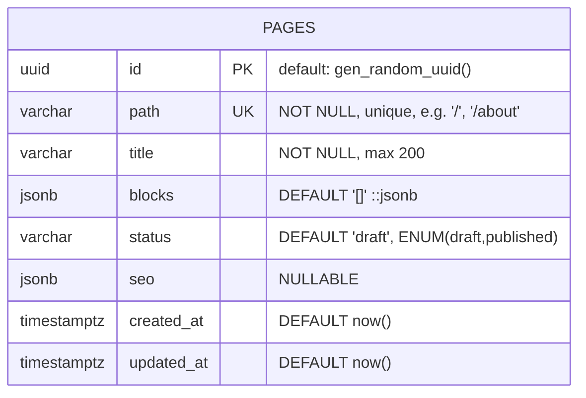
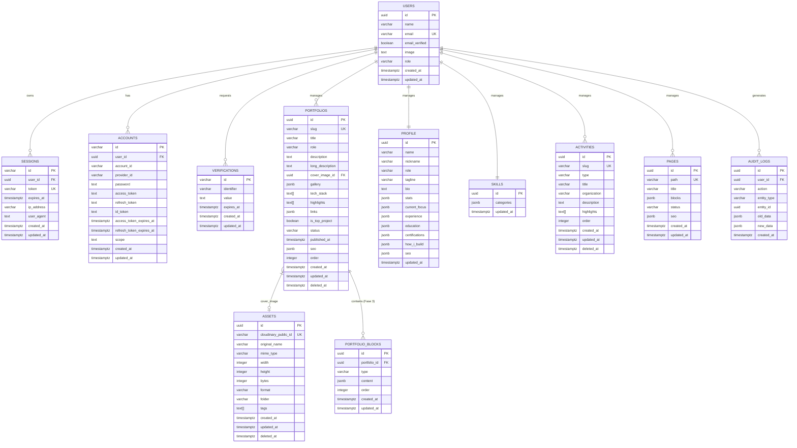

# ERD — Entity Relationship Diagram
## Portofx v2 Database Schema (Neon Postgres + Drizzle ORM 0.45.4)

> **Notation**: Crow's Foot (Mermaid)
> **Tool**: Mermaid.js (render di GitHub/VS Code/Notion)
> **Source of Truth**: `/db/schema/*.ts` (Drizzle definitions)
>
> **Auth**: Better Auth 1.7.20 (tables: `users`, `sessions`, `accounts`, `verifications`).
> **Data model**: flat first (Fase 1) + `portfolio_blocks` (Fase 3) + `pages` (Fase 4).

---

## 1. Overview Diagram



---

## 2. Detailed Table Definitions

### 2.1 Auth Tables (Better Auth compatible)



> **Catatan:** `password_hash` **tidak** ada di `users`; password disimpan di `accounts.password` (Better Auth).
> **Catatan:** `argon2` **tidak** dipakai; hash menggunakan **scrypt** dari `@noble/hashes`.

### 2.2 Portfolio Tables (Fase 1: flat + cover + gallery)

```mermaid
erDiagram
    PORTFOLIOS {
        uuid id PK "default: gen_random_uuid()"
        varchar slug UK "NOT NULL, unique, URL-friendly"
        varchar title "NOT NULL, max 200"
        varchar role "NOT NULL, max 100"
        text description "NOT NULL"
        text long_description "NULLABLE"
        uuid cover_image_id FK "REFERENCES assets(id) SET NULL"
        jsonb gallery "DEFAULT '[]' ::jsonb"
        text[] tech_stack "DEFAULT '{}'"
        text[] highlights "DEFAULT '{}'"
        jsonb links "DEFAULT '[]' ::jsonb"
        boolean is_top_project "DEFAULT false"
        varchar status "DEFAULT 'draft', ENUM(draft,published,archived)"
        timestamptz published_at "NULLABLE"
        jsonb seo "NULLABLE: {title, description, ogImage, noIndex}"
        integer "order" "DEFAULT 0"
        timestamptz created_at "DEFAULT now()"
        timestamptz updated_at "DEFAULT now()"
        timestamptz deleted_at "NULLABLE, soft delete"
    }

    PORTFOLIO_BLOCKS {
        uuid id PK "default: gen_random_uuid()"
        uuid portfolio_id FK "REFERENCES portfolios(id) CASCADE"
        varchar type "NOT NULL, ENUM(hero,gallery,text,video,embed,tech_stack,links,divider)"
        jsonb content "NOT NULL, validated by Zod per type"
        integer "order" "DEFAULT 0"
        timestamptz created_at "DEFAULT now()"
        timestamptz updated_at "DEFAULT now()"
    }

    ASSETS {
        uuid id PK "default: gen_random_uuid()"
        varchar cloudinary_public_id UK "NOT NULL, unique"
        varchar original_name "NULLABLE"
        varchar mime_type "NULLABLE"
        integer width "NULLABLE"
        integer height "NULLABLE"
        integer bytes "NULLABLE"
        varchar format "NULLABLE"
        varchar folder "DEFAULT 'portfolio'"
        text[] tags "DEFAULT '{}'"
        timestamptz created_at "DEFAULT now()"
        timestamptz updated_at "DEFAULT now()"
        timestamptz deleted_at "NULLABLE, soft delete"
    }
```

> `PORTFOLIO_BLOCKS` **Fase 3** — v1 tetap render flat fields (`long_description`, `highlights`, `tech_stack`, `links`).

### 2.3 Content Tables (Singletons & Lists)

```mermaid
erDiagram
    PROFILE {
        uuid id PK "default: gen_random_uuid()"
        varchar name "NOT NULL, max 100"
        varchar nickname "NULLABLE, max 50"
        varchar role "NOT NULL, max 100"
        varchar tagline "NULLABLE, max 200"
        text bio "NULLABLE"
        jsonb stats "DEFAULT '[]' ::jsonb"
        jsonb current_focus "NULLABLE: {title, description}"
        jsonb experience "DEFAULT '[]' ::jsonb"
        jsonb education "DEFAULT '[]' ::jsonb"
        jsonb certifications "DEFAULT '[]' ::jsonb"
        jsonb how_i_build "NULLABLE: {summary, steps[], why}"
        jsonb seo "NULLABLE"
        timestamptz updated_at "DEFAULT now()"
    }

    SKILLS {
        uuid id PK "default: gen_random_uuid()"
        jsonb categories "DEFAULT '[]' ::jsonb"
        timestamptz updated_at "DEFAULT now()"
    }

    ACTIVITIES {
        uuid id PK "default: gen_random_uuid()"
        varchar slug UK "NOT NULL, unique"
        varchar type "NOT NULL, ENUM(Volunteer,Publication,Leadership)"
        varchar title "NOT NULL, max 200"
        varchar organization "NOT NULL, max 200"
        text description "NULLABLE"
        text[] highlights "DEFAULT '{}'"
        integer "order" "DEFAULT 0"
        timestamptz created_at "DEFAULT now()"
        timestamptz updated_at "DEFAULT now()"
        timestamptz deleted_at "NULLABLE, soft delete"
    }
```

### 2.4 Page Builder Tables (Fase 4)



> `pages` sudah menyimpan `blocks` sebagai JSONB; **tidak perlu** `PAGE_BLOCKS` terpisah.

---

## 3. Relationship Cardinality & Rules

| Relationship | Cardinality | Rule |
|---|---|---|
| User → Sessions | 1 : N | Cascade delete sessions on user delete |
| User → Accounts | 1 : N | Cascade delete accounts on user delete |
| User → Verifications | 1 : N | Cascade delete verifications on user delete |
| User → Portfolios | 1 : N | Created by user, soft delete portfolio |
| Portfolio → Blocks | 1 : N | Fase 3; ordered by `order`, cascade delete |
| Portfolio → Cover Asset | N : 1 | Optional, SET NULL on asset delete |
| Portfolio → Gallery | N : M | JSONB array referencing `assets.id` |
| User → Profile | 1 : 1 | **Singleton** — enforced at app level (1 row) |
| User → Skills | 1 : 1 | **Singleton** — enforced at app level (1 row) |
| User → Activities | 1 : N | Ordered by `order`, soft delete |
| User → Pages | 1 : N | Fase 4; path unique |

---

## 4. Indexes Strategy

```sql
-- Auth (Better Auth)
CREATE UNIQUE INDEX users_email_idx ON users(email);
CREATE INDEX sessions_user_id_idx ON sessions(user_id);
CREATE INDEX sessions_token_idx ON sessions(token);
CREATE INDEX sessions_expires_at_idx ON sessions(expires_at);
CREATE INDEX accounts_user_id_idx ON accounts(user_id);
CREATE UNIQUE INDEX accounts_provider_account_idx ON accounts(provider_id, account_id);
CREATE INDEX verifications_identifier_idx ON verifications(identifier);
CREATE INDEX verifications_expires_at_idx ON verifications(expires_at);

-- Portfolio
CREATE UNIQUE INDEX portfolios_slug_idx ON portfolios(slug) WHERE deleted_at IS NULL;
CREATE INDEX portfolios_status_idx ON portfolios(status);
CREATE INDEX portfolios_order_idx ON portfolios("order");
CREATE INDEX portfolios_deleted_at_idx ON portfolios(deleted_at);
CREATE INDEX portfolio_blocks_portfolio_id_idx ON portfolio_blocks(portfolio_id);
CREATE INDEX portfolio_blocks_order_idx ON portfolio_blocks(portfolio_id, "order");

-- Assets
CREATE UNIQUE INDEX assets_cloudinary_public_id_idx ON assets(cloudinary_public_id);
CREATE INDEX assets_folder_idx ON assets(folder);
CREATE INDEX assets_created_at_idx ON assets(created_at);
CREATE INDEX assets_deleted_at_idx ON assets(deleted_at);

-- Content
CREATE UNIQUE INDEX activities_slug_idx ON activities(slug) WHERE deleted_at IS NULL;
CREATE INDEX activities_type_idx ON activities(type);
CREATE INDEX activities_order_idx ON activities("order");
CREATE UNIQUE INDEX pages_path_idx ON pages(path);
```

---

## 5. JSONB Content Schemas (Zod-Validated)

### 5.1 Portfolio Blocks Content Types (Fase 3)

```typescript
type PortfolioBlockContent =
  | { type: 'hero'; content: HeroContent }
  | { type: 'gallery'; content: GalleryContent }
  | { type: 'text'; content: TextContent }
  | { type: 'video'; content: VideoContent }
  | { type: 'embed'; content: EmbedContent }
  | { type: 'tech_stack'; content: TechStackContent }
  | { type: 'links'; content: LinksContent }
  | { type: 'divider'; content: DividerContent };

interface HeroContent {
  headline: string;
  subheadline?: string;
  ctaText?: string;
  ctaLink?: string;
  backgroundAssetId?: string;
  alignment: 'left' | 'center' | 'right';
}

interface GalleryContent {
  layout: 'grid' | 'masonry' | 'carousel';
  columns: 1 | 2 | 3 | 4;
  images: Array<{
    assetId: string;
    caption?: string;
    alt?: string;
  }>;
}

interface TextContent {
  content: string;
  size: 'sm' | 'base' | 'lg' | 'xl';
  alignment: 'left' | 'center' | 'right';
}

interface VideoContent {
  provider: 'youtube' | 'vimeo' | 'cloudinary' | 'direct';
  videoId: string;
  title?: string;
  caption?: string;
  autoplay: boolean;
  loop: boolean;
}

interface EmbedContent {
  url: string;
  title?: string;
  description?: string;
  width: number;
  height: number;
}

interface TechStackContent {
  title: string;
  categories: Array<{ name: string; items: string[] }>;
}

interface LinksContent {
  items: Array<{
    label: string;
    url: string;
    icon: string;
    variant: 'primary' | 'secondary' | 'outline';
  }>;
}

interface DividerContent {
  label?: string;
  style: 'solid' | 'dashed' | 'dotted' | 'gradient';
}
```

### 5.2 Profile JSONB Structure

```typescript
interface ProfileData {
  name: string;
  nickname?: string;
  role: string;
  tagline?: string;
  bio?: string;
  stats: Array<{ label: string; value: string }>;
  currentFocus?: { title: string; description: string };
  experience: Array<{
    role: string;
    organization: string;
    period: string;
    description?: string;
  }>;
  education: Array<{
    institution: string;
    degree: string;
    gpa: string;
    highlights: string[];
  }>;
  certifications: Array<{ name: string; issuer: string }>;
  howIBuild?: {
    summary: string;
    steps: Array<{ step: string; detail: string }>;
    why: string;
  };
  seo?: { title?: string; description?: string };
}
```

### 5.3 Skills JSONB Structure

```typescript
interface SkillsData {
  categories: Array<{
    category: string;
    items: string[];
  }>;
}
```

### 5.4 Pages Blocks (Fase 4)

```typescript
// Same block types as portfolio_blocks, but for page-level composition
interface PageBlock {
  type: BlockType;
  content: PortfolioBlockContent['content'];
  order: number;
}
```

---

## 6. Migration History (Drizzle)

| Version | File | Description |
|---|---|---|
| `0000` | `0000_initial_schema.sql` | Auth + portfolio + content + assets (Fase 1) |
| `0001` | `0001_add_portfolio_blocks.sql` | `portfolio_blocks` (Fase 3) |
| `0002` | `0002_add_pages.sql` | `pages` (Fase 4) |
| `0003` | `0003_add_audit_log.sql` | `audit_logs` (Fase 5, optional) |

> **Generate**: `pnpm db:generate` → creates SQL in `db/migrations/`
> **Apply**: `pnpm db:migrate` → runs against Neon

---

## 7. Data Integrity Rules (Application-Level)

| Rule | Enforcement |
|---|---|
| **Singleton Profile** | `INSERT ... ON CONFLICT DO NOTHING` + app check `count(*) === 1` |
| **Singleton Skills** | Same as Profile |
| **Portfolio slug unique** | DB unique index + app check before insert |
| **Published portfolio has flat fields** | App validation `title`, `role`, `description`, `techStack` non-empty (v1) |
| **Published portfolio has blocks** | Fase 3: app validation before `status = 'published'` |
| **Cover image exists** | App check `assets.id` exists before assign |
| **Block order contiguous** | Fase 3: app renumber on reorder (0, 1, 2...) |
| **Soft delete only** | No `DELETE` statements, only `UPDATE deleted_at = now()` |
| **Asset cleanup** | Cron job: delete Cloudinary assets where `assets.deleted_at > 30 days` |

---

## 8. Backup & Recovery

| Strategy | Frequency | Retention |
|---|---|---|
| **Neon PITR** | Continuous (WAL) | 7 days (free), 30 days (pro) |
| **Branch per deploy** | On each deploy | 30 days (manual cleanup) |
| **Logical backup (pg_dump)** | Daily (GitHub Actions) | 90 days (R2/S3) |
| **Schema migration history** | Every `db:generate` | Forever (git) |

---

## 9. Visual ERD (Mermaid Full)



---

> **Next**: Lihat `/docs/TASKS.md` untuk breakdown actionable per fase, `/docs/DESIGN.md` untuk keputusan UI/UX, `/docs/ENV.md` untuk environment variables, `/docs/MIGRATION_LOG.md` untuk tracking progress.
